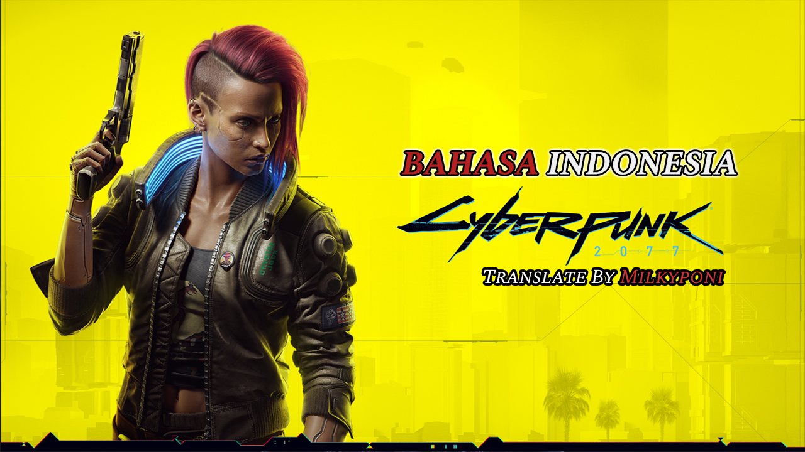

<p align="center">
  
</p>

<h1 align="center">Cyberpunk 2077 & Phantom Liberty — Indonesian Localization Mod</h1>

<p align="center">
  <b>Mod Lokalisasi & Subtitle Bahasa Indonesia Lengkap untuk Cyberpunk 2077 + DLC Phantom Liberty (PC Steam / GOG / Epic)</b><br>
  <i>Penyelia & Pengarah: Milky Poni | Rekayasa Mod & Lokalisasi: Ochi (Milky Brain)</i>
</p>

<p align="center">
  <a href="https://github.com/Milkyponi/Cyberpunk2077IndoLocalization/releases"></a>
  
  
  
  
  <a href="https://trakteer.id/milkyponi"></a>
</p>

---

Mod lokalisasi Bahasa Indonesia untuk mahakarya RPG aksi futuristik **Cyberpunk 2077 beserta ekspansi Phantom Liberty** (PC) karya **Milky Brain Game Modding & Localization Division**.

Dirancang khusus bagi gamer Indonesia yang ingin merasakan atmosfer gelap, dingin, dan kerasnya Night City serta zona berbahaya Dogtown—dalam Bahasa Indonesia yang hidup, luwes, alami, berkarakter kuat, dan berbobot sastra cyberpunk *gritty* tanpa terjemahan mesin yang kaku (anti-Google Translate).

---

## ✨ Fitur Utama & Standar Kualitas Lokalisasi

### 1. Terjemahan Kontekstual & Penuh Jiwa Karakter (Context-Aware)
Diterjemahkan secara mendalam berbasis adegan utuh (*scene-level*), menjaga emosi otentik, kimia percakapan, dan persona unik setiap karakter:
* **V & Johnny Silverhand**: Dinamika relasi sinis, sarkastik, penuh umpatan santai jalanan khas gamer Indonesia ("gue/lo", "nggak", "udah").
* **Songbird (So Mi)**: Manipulatif, cerdas, rapuh, dan emosional saat terjepit di antara intrik Blackwall dan NUSA.
* **Solomon Reed**: Dingin, disiplin militer, mantan agen rahasia FIA yang terbelah antara sumpah negara dan moralitas pribadi.
* **Rosalind Myers**: Karismatik namun berdarah dingin, mencerminkan watak politisi presiden korporat.
* **Kurt Hansen & Milisi Barghest**: Otoriter, intimidatif, lugas, menguasai pasar gelap Dogtown dengan tangan besi.
* **Karakter Pendamping (Judy, Panam, River, Kerry, Rogue, Peralez)**: Persona jalanan akrab Judy, kehangatan nomad garang Panam Aldecaldos, integritas moral River Ward, keglamoran sinis Kerry Eurodyne, dan tata krama berwibawa Mr. Hands.

### 2. Standar Kebijakan Bahasa Resmi (English UI / Indonesian Narrative)
* **Dialog, Cerita, & Lore (100% Bahasa Indonesia)**: Seluruh alur percakapan, cutscene, lore shard rahasia, obrolan SMS, codex ensiklopedia, berita web internet Net54, dan barks pertempuran diterjemahkan ke Bahasa Indonesia.
* **UI, HUD, & Menu (100% Original English)**: Menu utama, pengaturan grafis/audio, inventaris, dan HUD tempur dipertahankan dalam Bahasa Inggris original guna menjaga familiaritas gaming internasional.
* **Nama Senjata, Cyberware, & Judul Quest (100% Original English)**: Nama senjata (*Widow Maker*, *Skippy*), implan cyberware (*Sandevistan*, *Gorilla Arms*, *Kerenzikov*, *Mantis Blades*), nama brand korporat (*Militech*, *Arasaka*, *Zetatech*), dan judul quest (*The Heist*, *Pyramid Song*, *Dog Eat Dog*) tetap original English agar pemain tetap mudah mengikuti panduan build internasional. Seluruh penjelasan deskripsi mekanik, fungsi implan, dan efek stat di bawahnya diterjemahkan ke Bahasa Indonesia.

### 3. Sinkronisasi Fonetik Kata Terbata-Bata (*Phonetically-Synced Stutters*)
Menghilangkan cacat fatal penjiplakan huruf asing pada dialog gagap/terbata-bata:
* *"b-but"* ➔ *"t-tapi"* (bukan *"b-tapi"*)
* *"w-what"* ➔ *"a-apa"* (bukan *"w-apa"*)
* *"w-wait"* ➔ *"t-tunggu"* (bukan *"w-tunggu"*)
* *"c-consequences"* ➔ *"k-konsekuensi"* / *"a-akibat"*
* *"Mur... mu... murder!"* ➔ *"Pem... pe... pembunuh!"*

### 4. Zero-Dependency Native Architecture (Bebas Crash CPU & Mod Loader)
* Mod dikemas langsung menggunakan container native engine REDengine 4 (`archive/pc/mod/cp2077_indo.archive`).
* **TIDAK MEMERLUKAN** mod loader pihak ketiga apa pun (Bebas RED4ext, bebas ArchiveXL, bebas winmm.dll).
* **Bebas Crash Instruksi CPU Modern**: Kompatibel penuh untuk semua prosesor lama tanpa AVX2 / AVX-512 (menghindari error fatal 998 / `STATUS_ILLEGAL_INSTRUCTION`).
* **Memory-Mapped Page Alignment (4096-Byte)**: Struktur indeks tabel archive di-pad tepat pada kelipatan 4KB untuk mencegah freeze/hang permanen saat memuat memory-mapped files di Proton/Linux dan Windows.

---

## 📊 Cakupan Konten (100% Paripurna — 149.824 Entri Naskah / ~1,51 Juta Kata)

| Bagian Mod | Cakupan Konten Game | Berkas Biner | Entri Naskah | Estimasi Kata |
|---|---|---|---|---|
| **Batch 0** | Proof of Pipeline & Precedence (`q001` The Rescue) | 4 file CR2W | 120 entri | ~1.500 w |
| **Batch 1** | Cerita Utama Base Game (Babak 1, 2, 3, Seluruh Ending & Epilog) | 303 file CR2W | 19.871 entri | ~159.200 w |
| **Batch 2** | Cerita Utama Phantom Liberty & Dogtown Gigs (`q301-q307`, `mq300-306`) | 341 file CR2W | 23.361 entri | ~193.800 w |
| **Batch 3** | Companion Quests (Judy, Panam, River, Kerry, Rogue) & Fixer Gigs | 874 file CR2W | 32.901 entri | ~262.500 w |
| **Batch 4** | OnScreens Lore (Shards, SMS, Codex, Web Net54, Jurnal, Perks/Items) | 2 kontainer | 43.189 entri | ~652.200 w |
| **Batch 5** | Ambient Barks, Combat Voicesets Musuh, Pedagang, Media Radio/TV | 2.321 file CR2W | 30.502 entri | ~250.900 w |
| **TOTAL** | **Seluruh Konten Game dari Awal hingga Tamat Paripurna** | **3.841 berkas** | **149.824 baris** | **~1.518.000 kata** |

---

## 💾 Panduan Pemasangan

Unduh paket rilis mod dari tab [Releases](https://github.com/Milkyponi/Cyberpunk2077IndoLocalization/releases):
* **Nama Berkas:** `Cyberpunk_2077_Indonesian_Translation_v1.0.0.zip` (~6.4 MB)

### Cara 1: Metode Timpa Langsung (Paling Mudah & Direkomendasikan)
1. Ekstrak file `Cyberpunk_2077_Indonesian_Translation_v1.0.0.zip`.
2. Buka folder `TIMPA_KE_FOLDER_GAME`.
3. Salin (copy) folder `archive` yang ada di dalamnya.
4. Buka folder instalasi game Cyberpunk 2077 Anda:
   * **Steam Windows:** `C:\Program Files (x86)\Steam\steamapps\common\Cyberpunk 2077\`
   * **GOG Windows:** `C:\GOG Games\Cyberpunk 2077\`
   * **Epic Games:** `C:\Program Files\Epic Games\Cyberpunk 2077\`
   * **Linux / Steam Deck:** `~/.local/share/Steam/steamapps/common/Cyberpunk 2077/`
5. Tempelkan (paste) folder `archive` tersebut ke folder game Cyberpunk 2077 Anda.
   *(Pastikan file mod berada di: `<Folder Game>\archive\pc\mod\cp2077_indo.archive`)*.
6. Mainkan game! Mod langsung aktif otomatis (*zero-config*).

---

### Cara 2: Skrip Otomatis
* **Pengguna Windows:** Klik dua kali file `INSTALL.bat` di dalam folder ekstraksi, lalu masukkan path folder game Anda.
* **Pengguna Linux / Steam Deck:** Buka terminal di folder ekstraksi, jalankan:
  ```bash
  chmod +x INSTALL.sh && ./INSTALL.sh
  ```

---

## 🔄 Cara Menghapus Mod (Rollback ke Bahasa Asli)

Cukup hapus satu berkas mod dari direktori game Anda:
```
<Folder Game>/archive/pc/mod/cp2077_indo.archive
```
Game Anda akan langsung kembali 100% original bahasa Inggris tanpa perlu verifikasi ulang file game.

---

## 👥 Kredit & Kontributor

* **Executive Producer & Direction**: Milky Poni (CEO Milky Brain)
* **Lead Modder, Reverse-Engineering & Localization**: Ochi (Head of Game Modding & Localization Division)
* **Tooling & Serializer**: `cp2077-loc` pure-Python CR2W & RDAR packer by Milky Brain
* **Original Game**: © CD PROJEKT S.A.

---

## ☕ Dukung Proyek Ini (Donate)

Jika mod lokalisasi Bahasa Indonesia ini bermanfaat bagi pengalaman bermain Anda, Anda dapat memberikan dukungan pengembangan kepada **Milky Poni** melalui Trakteer:

<p align="center">
  <a href="https://trakteer.id/milkyponi">
    
  </a>
</p>

- **Link Trakteer**: [https://trakteer.id/milkyponi](https://trakteer.id/milkyponi)

---
<p align="center"><i>Dibuat dengan dedikasi penuh untuk komunitas gamer Cyberpunk 2077 Indonesia oleh Milky Brain.</i></p>
